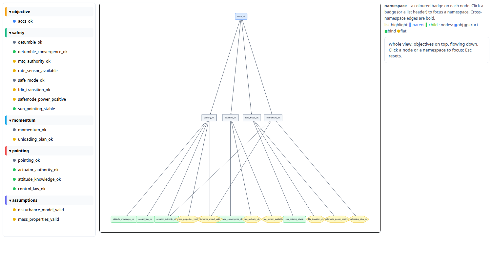
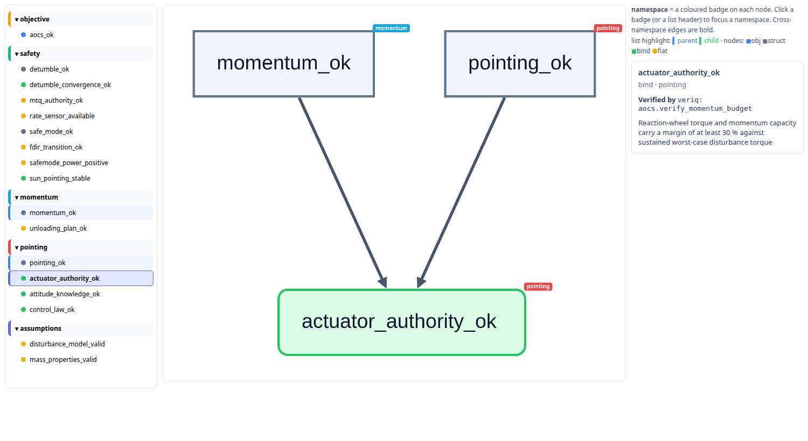
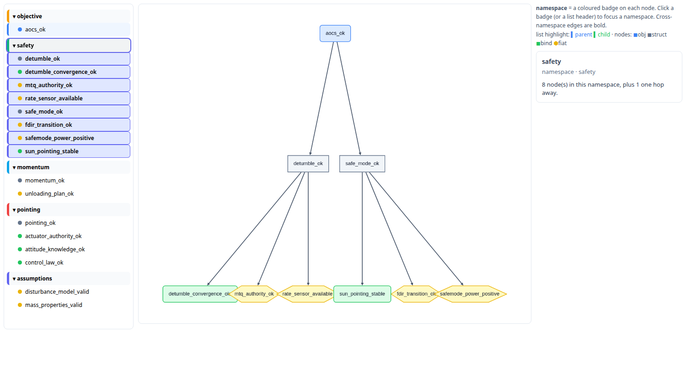

# inka — Web UI

Invariants the interactive graph viewer holds. The viewer is a read-only
visualization of the argument, built on the same shared model as every other
output.
Japanese version: [日本語版](https://www.space.t.u-tokyo.ac.jp/inka/ja/design/web-ui/).

## Screens

## Foundation

- The viewer renders the shared argument view — the same read-only projection the
  Markdown report uses — as cytoscape `elements` JSON from `inka export`. It never
  parses or mutates the argument.
- It is strictly read-only: nothing in the UI links to, or triggers, an action
  that changes the argument, approvals, or any other state.
- The argument is a DAG. Every node appears exactly once; a node with multiple
  parents is shown through edges, never by duplication.
- Rendering is deterministic: node identity and ordering derive from the view's
  sorted block-ID order, so the same project always renders the same graph.
- Implementation: the renderer is a single TypeScript front-end bundle (`web/`,
  the one source of these invariants), served by `inka serve` (Rust) with the
  argument's cytoscape JSON from `inka export`. The graph library is vendored into
  the bundle, not part of inka.

## Layout

- Whole view: a top-down layered DAG — objectives at the top, edges flowing
  downward — so the upstream requirements are always identifiable.
- Node focus: the direct parents sit above, the focused node in the middle, the
  direct children below.
- Namespace focus: the namespace's nodes plus every node one hop away, laid out
  top-down.
- Within any rank, nodes are ordered so that same-namespace nodes are adjacent,
  in a namespace order that is consistent across ranks (namespaces read as
  near-vertical bands).
- The laid-out graph's aspect ratio matches the graph window in every state
  (focus and whole view). Matching only ever stretches the short axis, never
  compresses, so nodes never begin to overlap.

## Nodes

- A node's shape and fill encode its discharge mode (objective / structure /
  bind / fiat); the four are visually distinct.
- A node auto-sizes to its label.
- The label is the node id; the description is never rendered inside the node.

## Edges

- Every edge is drawn with the same weight.
- An edge points from a parent to each of its children (arrowhead at the child).

## Namespaces

- A namespace is shown as a coloured badge on each node, in every state; there is
  no enclosing box or outline.
- Badges are hidden below a zoom threshold and appear once zoomed in.
- A namespace is a focus target from both surfaces: a node's badge in the graph
  and a namespace header in the list.
- Until namespace resolution lands, a node's namespace is its argument-file stem.

## Focus and navigation

- The only focus targets are a single node (→ the node with its direct parents
  and children) and a namespace (→ its members with their one-hop neighbours).
- "One hop" means direct parents and children only.
- Esc, or a tap on the empty background, clears the focus and restores the whole
  view.

## Node list

- The list contains every node, grouped by namespace; the groups are in
  topological order and the nodes within a group are in topological order.
- Clicking a node entry focuses that node; clicking a namespace header focuses
  that namespace.
- On focus, related entries are highlighted — parents in one colour, children in
  another — and the focused node or namespace is emphasized.
- The list and the graph agree on structure and ordering; both derive from the
  shared view.

## Detail

- Hovering a node reveals its full description.
- An edge whose `children:` entry carries a comment is drawn dashed, and
  hovering it reveals the parent, the child, and the comment.
- Selecting a node shows its contract, evidence target, children, and deadline,
  each with the comment attached to it; each child is listed with the comment
  on its entry, so no comment is reachable only by hovering.

## Not invariant

- Colours, zoom thresholds, badge size, spacing, and node dimensions are
  presentation parameters, tuned freely; they are not invariants.

## References

- `concept.md` core idea 1 (the four discharge modes the nodes make visible)
- `full-plan.md` capability 10 (visualization: read-only, unreachable from
  approval flows)
