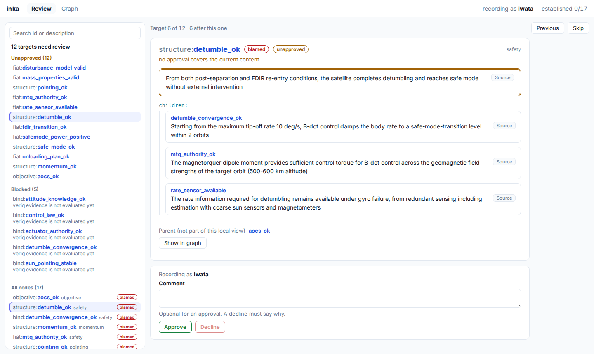
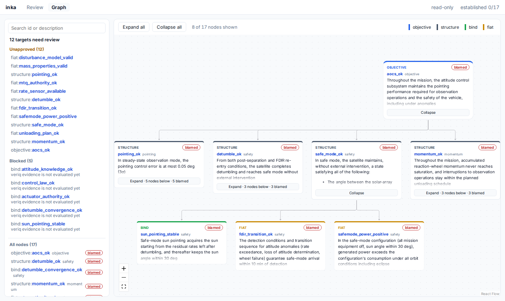
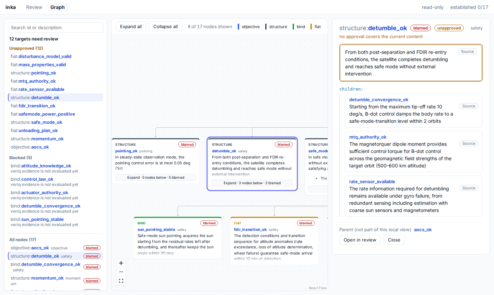

# inka — Web UI

Invariants the Web UI holds. It is one application with two surfaces, built on the same shared model as every
other output: a **review surface**, where an approver walks the review queue and records decisions as
`inka review` does, and a **graph surface**, where the whole argument is explored.
Japanese version: [日本語版](https://www.space.t.u-tokyo.ac.jp/inka/ja/design/web-ui/).

## Screens

## Foundation

- The Web UI shows the shared argument view — the same projection every other output is built on — together
  with the review queue and the evaluation the core derives from it.
- Meaning is decided in Rust, once. The front end never parses the argument and derives nothing that carries
  meaning: no hash, no review state, no verdict, no queue order, no ordering or grouping of nodes. Those come
  from the core, through the server, exactly as `inka review` and `inka eval` read them. The front end decides
  only where things are drawn and what the viewer has open — layout, expansion, selection, search text.
- The data the server sends has one definition, in Rust. The front end's types are generated from it; the bundle
  holds no hand-written copy that could drift.
- The server keeps no state of its own. Every answer is derived from the repository's files at the time of the
  request, so the page and the command line never disagree about what the project says. A project that fails
  `check` is shown as its diagnostics, never as a partial argument.
- The only thing the Web UI can change is the approval log, and only by appending one record
  (see [Recording a decision](#recording-a-decision)). Nothing in it edits the argument, the values, the
  evidence, or an existing record.
- The argument is a DAG. Every node appears exactly once in the graph; a node with multiple parents is shown
  through edges, never by duplication.
- Rendering is deterministic: identity and ordering derive from the view's sorted block-ID order and from the
  queue's order, so the same repository content always renders the same pages.
- Implementation: the renderer is a single TypeScript front-end bundle (`web/`, the one source of these
  invariants), served by `inka serve` (Rust). The graph library is vendored into the bundle, not part of inka.

## The local view

The local view is the unit both surfaces present a node in. It is what an approval binds to
(`concept.md` core idea 2), so it is what a reviewer reads.

- A node's local view shows, in this order: the comment on the block, the description, the evidence reference,
  the direct children's descriptions — each with the comment on its entry — and the deadline annotations, each
  property with the comment attached to it. This is the content and the order `inka review` prints.
- The description under judgement is visually set apart from the children's descriptions around it.
- Nothing deeper is shown, and nothing is expanded in place: a child appears as its description only. Reading
  below a child means navigating to that child's own local view.
- Each child also says where it stands: its [status](#node-status), and what the status needs said beyond its
  name — every reason a blamed child fails on, or how many blamed nodes lie below a child that is not
  established only because of them. The queue offers a parent whatever state its children are in, and a blocked
  child is never offered at all, so without this a reviewer could not tell why a parent turned up before the
  claims under it. `inka review` writes the same in the child's frame. The status is not contract content — no
  approval binds to it — and it is set apart from the child's description.
- A declined child that is a structure says who declined it and not why. The comment on such a decline argues
  about how the structure is built from its own children, which the parent's local view does not show; quoted
  there it would read as a remark on the parent's content. It is read in the structure's own local view.
- Everything that enters the view hash is on screen without a hover, a click or a scroll inside a nested box:
  no contract content is reachable only through an interaction. The one exception is the exact spacing of a
  description — the whitespace and line breaks that rendering it as Markdown folds — which is read in the
  description's source (see [Contract text](#contract-text)).
- The header names the target (`<mode>:<id>`) and its [status](#node-status), and, for a queued target, its
  review state.

## Node status

- Every node carries the verdict `inka eval` gives it: established or not.
- A node that is not established is one of two things, and the two are told apart: *blamed* — it fails through a
  cause of its own, named as `inka eval` names it (no approval, stale approval, declined, `until:` expired,
  evidence missing, evidence failed) — or unestablished only because something below it is.
- This status is what is shown wherever a node is named with a state: a card, a local view's header, a child in
  its parent's local view, a sidebar entry, a hover preview. It is always spelled out; colour repeats it and
  never carries it alone.
- The count `inka eval` prints — established nodes out of all nodes — is always visible.
- The review queue's states (unapproved, stale, declined, blocked) are the same validity function read from the
  approver's side, so a node's status and its place in the queue never disagree.

## Contract text

- A description is rendered as CommonMark. Comments, ids and evidence targets are plain text.
- Rendering never hides or alters contract content. Raw HTML in a description is shown as text, not
  interpreted. No remote resource is loaded: an image is shown as its alternative text and destination, and a
  link shows where it leads.
- The description's source — the interpolated, normalized text the hash is computed from — is one control away
  from its rendering. Rendering is for reading: every word of the description is on screen in it, but Markdown
  folds whitespace and line breaks, and those are contract content too. The source is where they are inspected,
  and this is the only contract content that takes an interaction to see.
- Text from the argument is never executed or trusted as markup beyond CommonMark; control and bidirectional
  override characters are neutralized as `inka review` neutralizes them.

## Review surface

- The queue is the one `inka review --list` prints: the same targets, grouped by state — unapproved, stale,
  declined, blocked — and ordered from the leaves up within each group.
- A session walks the targets that can take a decision — unapproved and stale — one local view at a time, in
  queue order. Declined and blocked targets are listed with what resolves them and offer no decision.
- A stale target names who approved the earlier content; a declined one names who declined.
- The reviewer may approve, decline, or skip. Any queued target can also be opened directly; the queue's order
  is a recommendation, not a gate.
- Progress — the position in the queue and what remains — is always visible.

## Recording a decision

A decision recorded in the browser is the record `inka review` writes: the same fields, the same file, appended
by the same code path. Nothing in the record tells the two apart.

- **Opt-in.** Recording exists only when the server was started with an approver (`inka serve --as <approver>`).
  Without one the server offers no route that writes, and the Web UI is read-only throughout.
- **Identity is the server's.** The approver, and the key id, are fixed when the server starts. The page shows
  who it records as at all times and cannot choose or change it.
- **Loopback only.** A server that records listens on a loopback address; asking for recording on any other
  address is refused at startup.
- **Own pages only.** A decision is accepted only from a page this server served for this run — another site
  open in the same browser cannot cause a record to be written.
- **The hash on screen.** A decision names the view hash of the local view that was displayed. The server
  records it only if that is still the target's current hash; otherwise nothing is written and the page shows
  the current content. An edit made while the page is open can never be approved unseen.
- **The whole local view.** Approve and decline are offered only on a local view shown in full, for a target
  that can take a decision. No control anywhere else — a graph card, a list entry, a hover — records anything.
- **Decline needs a reason.** A decline requires a comment; an approval may carry one.
- **Append-only.** One decision appends one record. No retraction, edit or deletion of a record is offered.

## Graph surface

- Every node is a card that carries its mode, its id, its [status](#node-status) and its description, rendered
  as in the local view. A long description may be clipped on the card; the node's local view shows it whole.
- The four discharge modes (objective / structure / bind / fiat) are visually distinct and also named on the
  card.
- The layout is a top-down layered DAG — roots at the top, edges flowing downward. An edge points from a
  parent to each of its children (arrowhead at the child), and every edge is drawn with the same weight.
- An edge whose `children:` entry carries a comment shows that it does; the comment itself is read in the
  parent's local view.

### Exploring

- The graph hangs from its roots: the nodes no other node names as a child. They are the objectives the
  argument rests on and, when `inka check` warns of nodes no objective reaches, the topmost of those. Every node
  lies below at least one root, so none is left out of the graph.
- A root that no objective reaches is set apart from the objectives and marked as unreachable, as the warning
  says; it and everything below it are otherwise drawn and explored like the rest.
- The graph opens collapsed: the roots and their direct children are visible.
- A node with children is expanded or collapsed on its own. Expanding shows its direct children; collapsing
  hides every descendant that is not also reachable through another expanded, visible node.
- A collapsed node says that it has hidden children, how many nodes lie below it, and how many of those are
  blamed — so nothing is hidden silently, and what needs attention can be found without expanding everything.
- A node is visible exactly when it is a root or a child of an expanded, visible node. Whether a node is
  visible never depends on the order in which things were expanded.
- The whole graph can be expanded, and collapsed again, in one action.
- Revealing a node from elsewhere — a search result, a queue entry, a link in a local view — expands a path
  from a root down to it.

### Selecting

- Selecting a card opens that node's local view beside the graph; the graph stays in place. There is no
  separate one-hop graph for a node: the local view is the node's close-up.
- The local view lists the node's parents as supplementary navigation, set apart from the content the approval
  binds to.
- Esc, or a tap on the empty background, clears the selection.

## Supplementary information

Context that helps a reviewer but is not part of what an approval binds to. It is always visually separate from
the local view's contract content.

- **Sidebar.** On both surfaces a sidebar lists the review queue and every node of the argument, and finds
  nodes by id and by description text. An entry shows the node's mode and status; choosing one opens the node.
- **Hover.** Hovering a reference to a node — a child in a local view, a parent, a sidebar entry, a clipped
  card — previews that node's mode, id, status and description. A preview never offers a decision, and nothing
  is reachable only through one.
- **Namespace.** A node's namespace is shown with its id wherever the node is named. Until namespace resolution
  lands, a node's namespace is its argument-file stem.
- **Links between surfaces.** A local view on the review surface can be located in the graph, and a queued
  node selected in the graph can be opened in the review surface.

## Not invariant

- Colours, card dimensions, how many lines a card shows before clipping, spacing, zoom behaviour, sidebar
  layout and keyboard shortcuts are presentation parameters, tuned freely; they are not invariants.

## References

- `concept.md` core idea 1 (the four discharge modes the cards make visible) and core idea 2 (the local view an
  approval binds to)
- `spec.md` Comments (presentation at review), Approval records (the record a decision appends), Evaluation
  semantics (established and blame)
- `full-plan.md` capability 2 (approval-session upgrades) and capability 10 (visualization)
